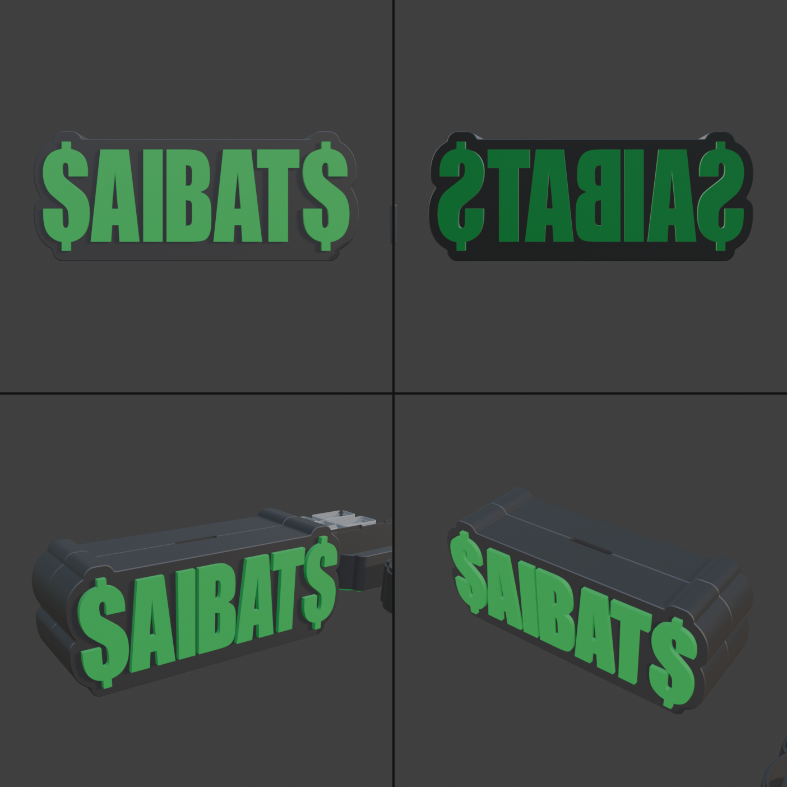

# AI 3D Printing Project

An AI agent that takes an order in plain words, a picture or a ready model and carries it all the way to a finished 3D print: Claude designs the part in Blender, picks the filament and settings, slices it, shows the result, and after the owner's explicit yes starts the print on a Bambu Lab P2S and watches it. The person only answers questions and takes the part off the bed.

<p align="center">
  
  
</p>

## What has been done

| Date | Result |
|---|---|
| 2026-11-02 | A stylised character (Hornet) modelled, shaded, lit and animated with wind-blown cloth, entirely through the agent pipeline. Files: [`designs/hornet/`](designs/hornet/), videos in [`designs/hornet/renders/`](designs/hornet/renders/). |
| 2026-11-12 | A 20 mm test cube printed, with the print started by Claude through the Bambu Studio window. |
| 2026-11-13, 2026-11-14 | The first real order: a two-colour name money box in two halves, taken through the whole pipeline from brief to printed part. Files: [`designs/aibat-bank/`](designs/aibat-bank/), including the [brief](designs/aibat-bank/brief.md), the [print plan](designs/aibat-bank/print/print-plan.md), the STL files and the sliced plate pictures. |

Current goal: one single-colour part goes from Blender to a finished print with the person only answering questions.

## How it works

Two [Model Context Protocol](https://modelcontextprotocol.io/) servers run from this checkout:

```
Claude ⇄ MCP server "blender" (src/blender_mcp) ⇄ TCP socket localhost:9876 ⇄ addon inside Blender (addon.py) ⇄ bpy

Claude ⇄ MCP server "print" (src/print_mcp) ─┬─ Bambu Studio command line → .gcode.3mf
                                             └─ Bambu Studio window (Win32 PrintWindow capture, PostMessage clicks) → Bambu Cloud → printer
```

- **`blender`** is a fork of [mcp-for-blender](https://github.com/ahujasid/blender-mcp) by Siddharth Ahuja. On top of it this project adds `export_for_print` ([`src/blender_mcp/print_export.py`](src/blender_mcp/print_export.py)), which writes objects as one millimetre STL with a mesh report, background render scripts in [`scripts/`](scripts/), and a team of agents.
- **`print`** is written from scratch for this project ([`src/print_mcp/`](src/print_mcp/)) and uses only the Python standard library besides the `mcp` package. It slices through the Bambu Studio command line, reads the sliced file, and sees and clicks the Bambu Studio window in the background, without taking the mouse or the screen from the person at the PC. Tools: `list_print_profiles`, `slice_model`, `inspect_sliced`, `studio_windows`, `studio_capture`, `studio_open`, `studio_click`.

There is no network link to the printer and no stored printer credentials: the agent works only through the Bambu Studio window with the owner's own cloud sign-in.

### Agents

The work is split between subagents defined in [`.claude/agents/`](.claude/agents/); the main session orchestrates them.

| Group | Agents |
|---|---|
| Asset production | `art-director` (reference to exact brief), `modeler`, `lookdev`, `animator`, `inspector` (independent check against the brief) |
| Printing | `print-engineer` (printability, filament, export, slice), `print-operator` (prepares the Bambu Studio window) |
| Development | `sniper`, `debugger`, `reviewer`, `tester`, `documenter` |

### Safety rules

A physical machine is involved, so the rules are strict. They are spelled out in [`CLAUDE.md`](CLAUDE.md):

- A print starts only after the owner's explicit yes for that one print, after they have seen the plate picture, time, weight, filament and AMS slot.
- Only the main session presses Send, pause or stop; subagents never do.
- Before sending, the agent checks the camera for an empty bed and compares the send dialog with the slice.
- Temperatures and G-code never leave the shipped filament profiles.
- The agent does not read account data or printer access codes.

## Requirements

- Windows 10 or 11 (the print server drives the Bambu Studio window through Win32)
- [Blender](https://www.blender.org/) 5.x
- [uv](https://docs.astral.sh/uv/)
- [Bambu Studio](https://bambulab.com/en/download/studio) and a Bambu Lab printer, for the print part
- [Claude Code](https://claude.com/claude-code) as the MCP client

## Setup

```powershell
git clone https://github.com/galamag/AI3DPrintingProject.git
cd AI3DPrintingProject
uv sync --frozen
powershell -NoProfile -ExecutionPolicy Bypass -File scripts\restart-blender.ps1
```

The last command installs the addon into Blender and starts it. Then open the folder in Claude Code: both servers start from [`.mcp.json`](.mcp.json), with telemetry switched off. Details, known traps of Blender and Bambu Studio, and the full workflow are in [`CLAUDE.md`](CLAUDE.md).

Tests:

```powershell
uv run --with pytest pytest
```

The live print tests run real slices and window captures when Bambu Studio is installed and skip otherwise. They never click and never print.

## Repository layout

| Path | Contents |
|---|---|
| `addon.py`, `src/blender_mcp/` | The Blender addon and MCP server (fork), with our print export module |
| `src/print_mcp/` | The print MCP server (ours) |
| `scripts/` | Addon deploy and restart script, background render scripts |
| `.claude/agents/` | Agent definitions |
| `designs/<slug>/` | Briefs, renders and print files of each order |
| `tests/` | Unit tests and live tests |

Reference images that the briefs mention (`designs/<slug>/reference/`) are third-party pictures and are not part of this repository.

## Credits and license

- Built on [mcp-for-blender](https://github.com/ahujasid/blender-mcp) by Siddharth Ahuja, MIT. See the upstream README for the base server's own documentation. [`TERMS_AND_CONDITIONS.md`](TERMS_AND_CONDITIONS.md) comes from upstream and covers its optional online services, which this fork keeps switched off.
- Hornet is a character from Hollow Knight: Silksong by Team Cherry. The model here is non-commercial fan art; the character belongs to Team Cherry.
- This is a third-party integration, not made by or affiliated with Blender Foundation or Bambu Lab.

Released under the [MIT License](LICENSE).
